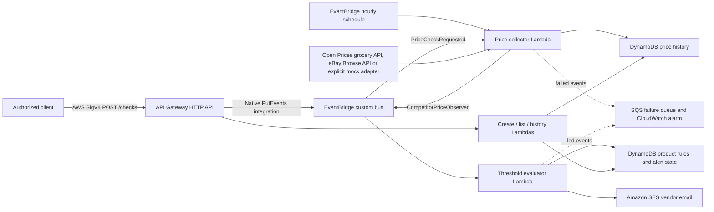

# Dynamic E-Commerce Pricing & Competitor Monitoring

An AWS serverless microservice that collects competitor prices, stores observations, and emails vendors when a configured undercut threshold is crossed. It recommends a price with a minimum floor; **it does not change a live store price**. Vendor notification satisfies the project's “update rates or notify vendors” deliverable.

The dashboard now contains **six grocery products** with barcode-matched public price observations, store comparisons, dated histories and explainable estimates. Its AWS presentation section discovers your actual deployment, checks security/configuration, links resources in the AWS console, and exports evidence. [Classroom demo guide](docs/real-pricing-demo.md).

Run `./scripts/start-demo.ps1 -Deploy` once to update the existing stack and open the UI; omit `-Deploy` later. The grocery adapter uses **Open Prices / Open Food Facts**, France/EUR, with visible observation dates. Prices are recorded evidence, not guaranteed current supermarket quotes. Teacher-facing AWS checks need the signed-in local profile. The default stack mode remains explicit mock for older demo rules; grocery products override it with their real source.

eBay Browse remains implemented and fixture-tested, requiring approved production credentials for real access. The brief names eBay/RapidAPI; the new grocery demo uses a different public external API. If the rubric mandates a named provider, real eBay/RapidAPI access remains a separate requirement. No failed real source silently falls back to mock data.

## Architecture



Product management uses synchronous Lambda handlers; check requests go directly from API Gateway to EventBridge. AWS IAM protects every HTTP route. There are no public write endpoints or browser-embedded AWS keys.

## Quick start

Requirements: Python 3.12, AWS CLI v2, SAM CLI, and a connected AWS profile permitted to deploy CloudFormation, IAM, Lambda, API Gateway, EventBridge, DynamoDB, SQS, SES, CloudWatch, and the SAM artifact S3 bucket. Docker is only needed for SAM's local Lambda emulator.

From the repository root in PowerShell:

```powershell
python -m pip install -r requirements-tools.txt
aws sts get-caller-identity --profile pricing-personal
.\scripts\deploy.ps1 -VendorEmail 'your-verified-email@example.com'
```

The script verifies the AWS identity, creates/checks the SES email identity, waits for you to click the verification email if necessary, validates and builds SAM, deploys `dynamic-pricing-demo`, and runs IAM-signed HTTP smoke checks. Default region is `ap-south-1`; override with `-Region`. The same address is the demo sender and recipient, so SES sandbox access is sufficient. Cloud resources may incur charges; inspect your own account's credits and billing settings.

The smoke check proves unsigned HTTP requests are blocked, creates or reuses `demo-001`, queues a check through the real API/EventBridge integration, waits for a new history record, and checks alert status. A fresh successful run reports `accepted_by_ses`; check the actual inbox to confirm delivery. Repeated runs can report `previous_alert_exists_cooldown_active` and do not prove a new email was sent. A pre-existing demo with different settings is preserved; select another ID with `-DemoProductId`.

See [Windows walkthrough](docs/getting-started.md) for individual commands and [submission checklist](docs/submission-checklist.md) for presentation evidence.

## HTTP interface

Sign requests with AWS Signature V4 (`execute-api`, deployment region). The demo script signs them automatically. Plain `Invoke-RestMethod` calls without AWS authentication will fail.

- `POST /products`: create a product; returns 201, invalid input 400, duplicate ID 409.
- `GET /products`: list rules and the most recent successful alert/recommendation, if any.
- `GET /products/{productId}/prices?limit=50`: newest observations first; limit 1–200; unknown product 404.
- `POST /checks`: body `{"productId":"demo-001"}`. The native integration returns EventBridge's HTTP 200 response: check `FailedEntryCount == 0` and `Entries[0].EventId`. This acknowledges queuing, not completion. Malformed check events fail asynchronously and are routed to the failure queue.

Example product body (replace the recipient):

```json
{
  "productId": "demo-001",
  "name": "Logitech M185 Wireless Mouse",
  "searchQuery": "Logitech M185 Wireless Mouse",
  "marketplace": "EBAY_US",
  "currency": "USD",
  "currentPrice": "29.99",
  "minimumPrice": "24.99",
  "undercutPercent": "5",
  "vendorEmail": "your-verified-email@example.com",
  "mockCompetitorPrice": "26.99",
  "mockShipping": "0.00",
  "active": true
}
```

Prices must be positive finite values with at most two decimal places. Shipping may be zero. IDs contain 1–64 letters, digits, hyphens or underscores. Supported marketplace/currency pairs: US/USD, GB/GBP, DE/EUR, CA/CAD and AU/AUD. `gtin` is optional for mock products and mandatory for eBay products. `deliveryPostalCode` can override the marketplace's demonstration destination. Grocery web products require `priceSource: "web"`, a fixed grocery `catalogId`, EUR/WEB_FR and `comparisonBasis: "recorded_grocery_item_price_excluding_delivery"`. The catalog is defined in `src/market.py`. Shipping remains unknown (`null`); alerts state the real observation date and recorded-price demo status. Older retail rules are retained only for backend compatibility and do not appear in the grocery UI. The signed product API exposes `lastAlertObservation` to correlate SES acceptance with the requested EventBridge ID.

## Pricing and alert behavior

The comparison uses **item price plus known shipping**. With current price 29.99 and undercut percentage 5, the threshold is 28.4905. A total strictly below it triggers an alert; equality does not. The recommendation is `max(minimumPrice, competitor total rounded to cents)`. The sample 26.99 price triggers a 26.99 recommendation; a competitor price of 20.00 produces a 24.99 recommendation.

Inactive products and mismatched currencies are ignored. DynamoDB conditional updates reserve an alert before sending; completed duplicates and the per-product cooldown suppress repeat emails. The default cooldown is 24 hours, including further price changes within that window. An unfinished lease remains retryable after a crashed worker. SES failure releases the lease and propagates the error for retries. SES acceptance and DynamoDB updates cannot form one atomic transaction: a crash after SES acceptance but before saving success can still cause a duplicate. This is not an exactly-once email guarantee.

Collection/publication failures raise errors. Lambda retries twice; exhausted invocations and EventBridge target-delivery failures go to the encrypted SQS failure queue. A CloudWatch alarm flags visible queue messages; it has no SNS/email action. Function logs retain 14 days. History records receive a 30-day TTL; DynamoDB removes expired items asynchronously.

## Enable live eBay later

1. Obtain active eBay production Browse API access. Sandbox keys do not return real listings; production access/approval is external to this repo. [eBay requirements](https://developer.ebay.com/api-docs/buy/buy-requirements.html).
2. Create a Secrets Manager secret containing `{"clientId":"...","clientSecret":"..."}`. Enter secrets locally; never commit or paste them into chat. Only the collector receives permission to read the supplied secret ARN.
3. Use a real matching product GTIN on every active live rule. Deactivate old mock-only products in DynamoDB before switching the stack to live mode. Keyword-only queries are deliberately rejected because they can select accessories or a different model.
4. Deploy with a new demo ID and real GTIN:

```powershell
.\scripts\deploy.ps1 -VendorEmail 'your-verified-email@example.com' -Live `
  -EbaySecretArn 'arn:aws:secretsmanager:REGION:ACCOUNT:secret:YOUR-SECRET' `
  -Gtin 'YOUR_REAL_PRODUCT_GTIN' -DemoProductId 'live-demo-001'
```

The adapter caches OAuth tokens, searches up to 50 new fixed-price listings by GTIN, filters currency, and selects the lowest total among results with known fixed shipping. Unknown shipping is skipped. Delivery context uses the product's postal code, with example destinations if omitted. Taxes, currency conversion, and seller trust scoring are not modeled. External API errors remain failures; they do not produce synthetic “live” prices. [Browse API](https://developer.ebay.com/develop/api/buy).

## Verify locally

```powershell
python -m pip install -r requirements-dev.txt
python -m unittest discover -s tests -v
sam validate --lint --region ap-south-1
sam build
```

Tests invoke public Lambda handlers against Moto AWS adapters and stub only the external eBay HTTP interface or deliberate AWS failures. They cover validation, threshold boundaries, floors, inactive rules, currency mismatches, collection/history, explicit source mode, token reuse, shipping safety, failed publication/email, duplicate suppression and interrupted-worker recovery. GitHub Actions repeats tests, template linting, and the build after a future push. No cloud credentials are used by local tests or CI.

## Demo scope and cleanup

A local dashboard is included for an easy presentation; it adds no hosted frontend service. Its histories belong to the selected grocery and one store. Collection timestamps are separate from source observation dates, and historical estimates are labeled. The scheduled collector scans a small catalog sequentially; large catalogs need per-product fan-out rather than a longer Lambda timeout. The listing API also scans the catalog and is intended for demo-sized data.

Deploy with `-DisableSchedule` to retain manual checks without polling. To remove the demo stack when finished, use `sam delete --stack-name dynamic-pricing-demo --profile pricing-personal --region ap-south-1`; review its deletion prompts. This removes stack resources and demo tables. The separately verified SES identity and any manually created eBay secret remain outside the stack.
